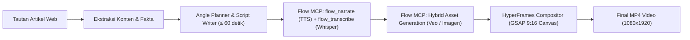

# Content Automation: Dynamic 9:16 Video Explainer Studio

Sistem mandiri (*standalone engine*) untuk mengubah artikel berita (Kumparan, portal berita umum, dan web) menjadi video explainer naratif 9:16 berkualitas tinggi secara dinamis.

Ditenagai oleh:
- **Google Flow MCP (`flow-mcp`)**: Menghasilkan Voice Over (Gemini TTS / Kokoro), ekstraksi timestamp ucapan per kata (Whisper), dan aset video B-roll / gambar still (Google Veo & Imagen).
- **HeyGen HyperFrames (`heygen-com/hyperframes`)**: Engine video deterministik berbasis standar web (HTML/CSS + GSAP paused timelines) yang merender komposisi safe-area, tipografi kinetik, dan metrik count-up menjadi file MP4 1080×1920 (30fps).
- **Multi-Theme Presets**: Pilihan tema grafis visual (`Tech/Modern Dark`, `Editorial Clean`, `Vibrant Social`).
- **Antigravity 2.0 Automation**: Penjadwalan (*scheduling & batch cron automation*) via Antigravity Agent.

---

## 🚀 Alur Kerja Sistem (Pipeline)



---

## 🛠️ Prasyarat & Persiapan

### 1. Kebutuhan Sistem
- **Node.js**: v20+ atau v22+
- **pnpm**: `pnpm install`
- **flow-mcp**: Terpasang di `~/flow-mcp` dengan token di `~/.flow-mcp/token`

### 2. Menjalankan Google Flow MCP Server
Pastikan server lokal `flow-mcp` aktif sebelum men-generate narasi atau aset:
```bash
# Menjalankan panel Studio dan server lokal di port 8787
pnpm flow:studio
```
> Jendela Chrome khusus Google Flow akan terbuka. Pastikan Anda sudah login ke akun Google untuk menggunakan 50 kredit gratis harian.

---

## 💻 Cara Menjalankan Aplikasi

1. **Jalankan Development Server**:
   ```bash
   pnpm dev
   ```
   Buka browser di [http://localhost:3000](http://localhost:3000).

2. **Halaman Antarmuka**:
   - `/composer`: Masukkan link artikel, brief tambahan, dan pilih Theme Preset.
   - `/workspace/[jobId]`: Tinjau angle editorial, edit naskah narasi, buat preview suara narator, dan klik **Approve & Generate Video**.

---

## 🧪 Uji Coba & Diagnostik

1. **Uji Koneksi Flow MCP**:
   ```bash
   pnpm test:flow
   ```
   *Memeriksa token lokal, port 8787, dan kuota kredit Google Flow.*

2. **Smoke Test Render HyperFrames**:
   ```bash
   pnpm test:hyperframes
   ```
   *Merender klip sampel 9:16 dengan tipografi kinetik GSAP menjadi MP4 lokal.*

---

## 🤖 Antigravity 2.0 Automation

Aplikasi ini dapat diotomatisasikan untuk memantau RSS feed berita dan membuat video explainer secara terjadwal.
Gunakan perintah slash Antigravity:
```text
/schedule "Setiap hari pukul 08:00 WIB, ambil artikel terpopuler kumparan.com dan jalankan pipeline video explainer di Content-automation"
```
Atau jalankan automation agent worker di `lib/automation/agentWorker.ts`.

