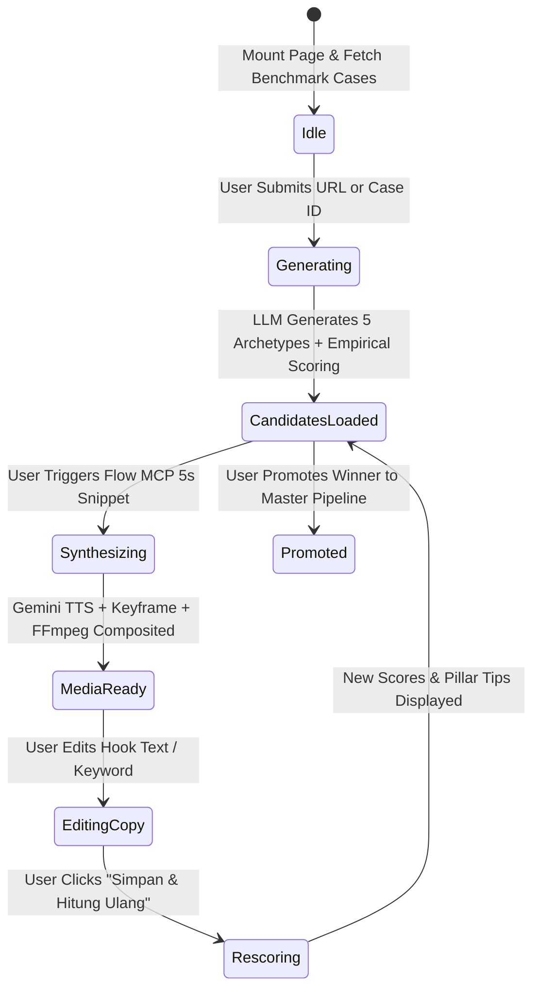

# UI Specification: Tactile & Interactive Hook Simulator
**Document Version:** 1.0.0  
**Owner:** Design-Dev Squad (UI Engineer - Next.js Specialist)  
**Standard:** 100% Precision Tactile Design System & App Router Architectural Invariants  

---

### 1. Tactile Design Philosophy & Invariants
The Hook Successor Engine UI is engineered around high-density investigative aesthetics, layered tactile feedback, and strict visual hierarchy:

1. **One Primary Action**: Exactly one dark high-contrast primary CTA per view (`bg-amber-500 hover:bg-amber-400 text-stone-950 font-bold`). Never compete for visual attention.
2. **Secondary Actions**: Recessed dark-slate/stone buttons (`bg-stone-800/80 border border-stone-700/60 hover:bg-stone-700 text-stone-200`) with subtle elevation and tactile click states.
3. **Tactile Spring Feedback**: All interactive elements (CTA buttons, archetype cards, input tabs) feature immediate physical tactile compression:
   ```css
   active:scale-[0.97] transition-all duration-150 ease-out
   ```
4. **Recessed Input Wells**: Input fields avoid generic flat borders; they utilize recessed dark wells (`bg-stone-900 border border-stone-800 rounded-xl focus:border-amber-500/50 focus:ring-1 focus:ring-amber-500/30`) that deepen in contrast upon focus.
5. **Mobile & Desktop Parity**: Minimum 44x44px touch targets on mobile viewports; responsive 12-column grid scaling smoothly to side-by-side split cards on 1440px displays.

---

### 2. Design Tokens & Color Palette

| Token Name | Tailwind / CSS Value | Semantic Purpose |
| :--- | :--- | :--- |
| `--bg-base` | `#0c0a09` (`stone-950`) | Deep Chiaroscuro studio backdrop |
| `--surface-card` | `#1c1917` (`stone-900/90`) | Elevated archetype card surface |
| `--surface-well` | `#141210` (`stone-950/80`) | Recessed input well & telemetry badge container |
| `--border-subtle`| `rgba(255, 255, 255, 0.08)` | 1px razor-sharp division line |
| `--brand-amber` | `#f59e0b` (`amber-500`) | Primary signal, winner highlight, high-velocity accent |
| `--score-emerald`| `#10b981` (`emerald-500`) | Superior benchmark delta (>= 90% retention) |
| `--score-crimson`| `#f43f5e` (`rose-500`) | Low retention warning / revision prompt |
| `--text-primary` | `#f8fafc` (`slate-100`) | High-contrast headline & transcript text |
| `--text-muted`   | `#94a3b8` (`slate-400`) | Telemetry labels, duration metadata, secondary notes |

---

### 3. Component Hierarchy & Layout Tree

```
app/hook-engine/page.tsx (Client Component: 'use client')
├── Header Navigation Bar
│   ├── Breadcrumb / Title: "HOOK SUCCESSOR ENGINE"
│   └── Live Environment Status Badge (Port 3000 Dev Server + Flow MCP Port 8787)
├── Case Dossier Ingestion Card (Tabs: Benchmark Library | Scrape Live URL | Raw Dossier Brief)
│   ├── Tab Selection Bar (Tactile tab triggers with active indicator)
│   ├── Benchmark Dropdown / URL Input Well / Brief Textarea Well
│   └── Primary Action Button ("⚡ Formulasikan 5 Hook & Prediksi Retensi")
├── Active Case Dossier Strip
│   ├── Case Title, Victim Count, Location, Key Evidence Pill Badges
│   └── Master Benchmark Reference Target (e.g., Bom Bali Amrozi HSI: 98)
├── Candidates Grid (A/B Testing Arena)
│   ├── Recommended Winner Banner (Card 01 or Highest HSI)
│   └── Archetype Candidate Cards (5 Cards in 1/2 Column Grid)
│       ├── Header: Archetype Tag, Rank Badge, Estimated Duration (s)
│       ├── Giant Keyword Flash Tag Preview (`bg-amber-500/10 text-amber-300 font-mono`)
│       ├── Hook Script Display (`"..."` cadence typography with Chiaroscuro quotation)
│       ├── Empirical 4-Pillar Telemetry Grid:
│       │   ├── Scroll-Stop Velocity (0-25)
│       │   ├── Cognitive Gap Tension (0-25)
│       │   ├── Muted Typography Punch (0-25)
│       │   └── Algorithmic Comment / Debate Trigger (0-25)
│       ├── Score Summary Badge (Total HSI / 100 & Predicted 3s Retention %)
│       ├── Flow MCP 5s Video Snippet Player:
│       │   ├── Interactive `<video>` Player (1080x1920 9:16 aspect-ratio container)
│       │   └── Synthesis CTA ("🎙️ Sintesis Video 5 Detik via Flow MCP")
│       ├── In-Line Copy Editor (Toggleable: Hook Text + Giant Keyword)
│       └── Action Footer:
│           ├── "Edit Copy & Rescore" Button
│           └── "Promosikan Hook Ini ke Master Video" CTA
└── Master Promotion Locked Banner (Appears when winning hook is promoted)
    ├── Confirmed Winner Archetype & Text
    └── 1-Click "Export / Launch Master Video Production" Trigger
```

---

### 4. Interactive State Machine


